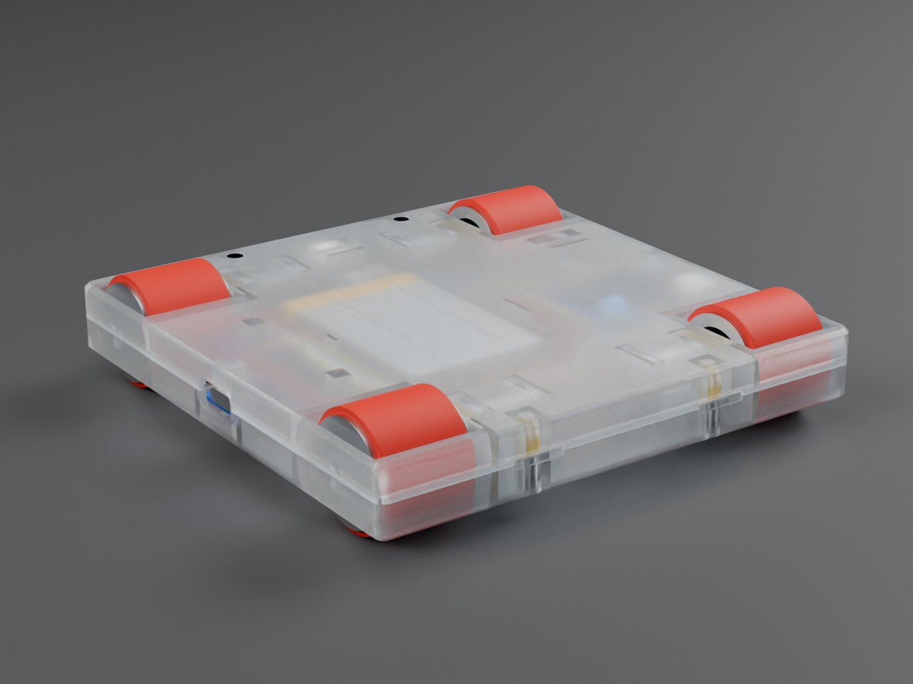
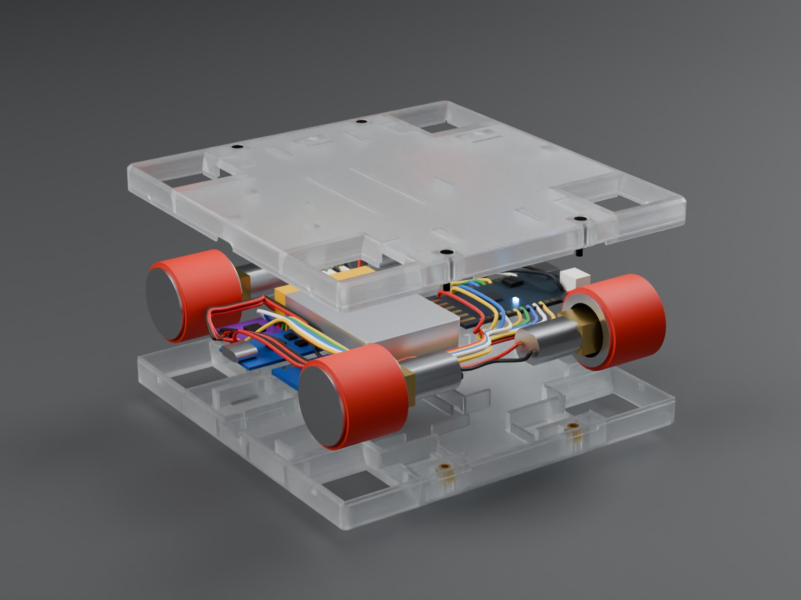
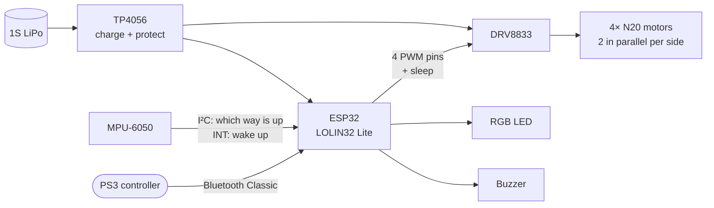
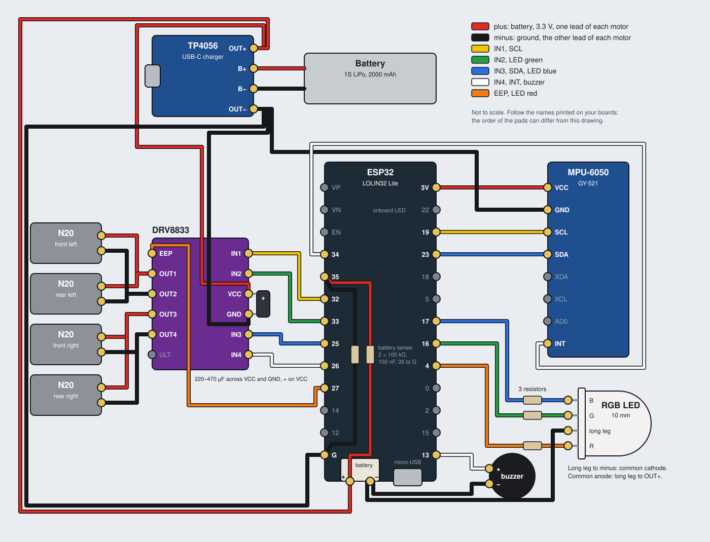
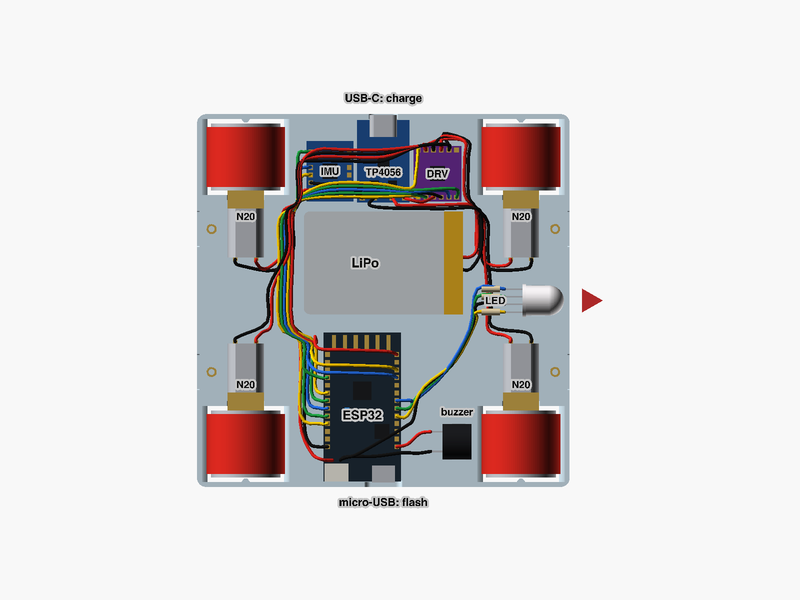
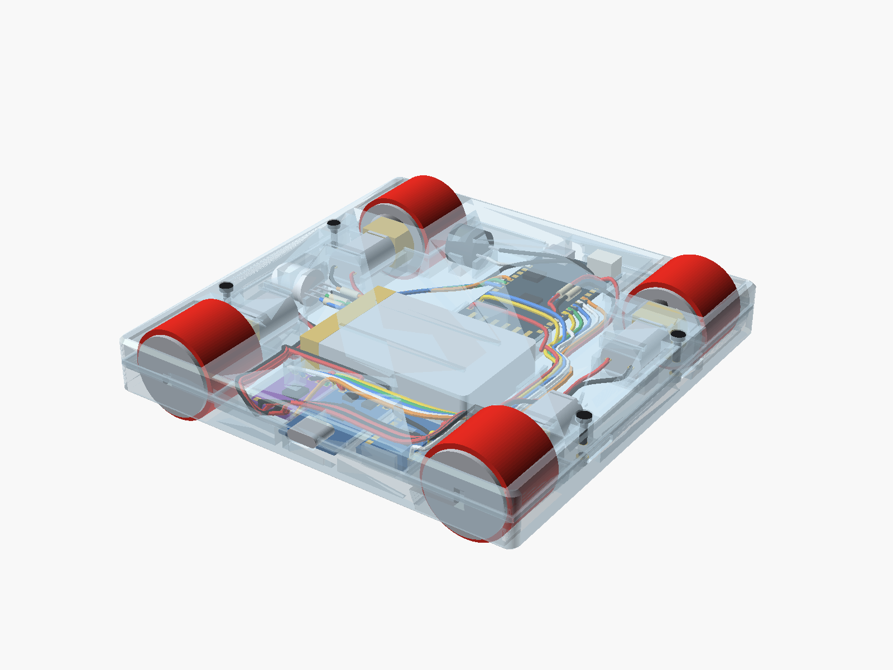
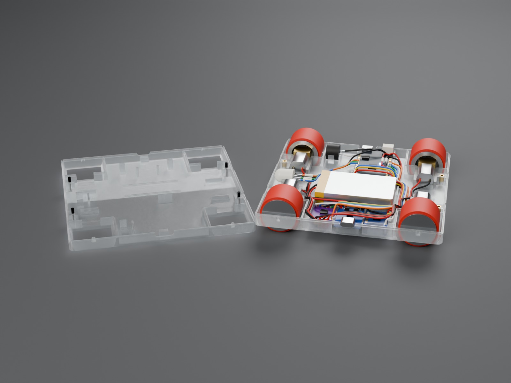

# minibot

A small invertible 4WD ESP32 robot driven by a PS3 controller over Bluetooth.

[](https://github.com/wouterds/minibot/actions/workflows/build.yml)
[](https://platformio.org)



## Overview

- **ESP32 (WeMos LOLIN32 Lite)** with Bluetooth Classic
- **PS3 DualShock 3 controller** as the remote
- **4× N20 6 V / 400 RPM** gear motors, paired left and right on one **DRV8833** dual H-bridge
- **MPU-6050 IMU**: when the bot lands on its back, forward stays forward. It also wakes the bot from sleep, so there is no power switch
- **10 mm RGB LED** at the front: it lights the hull and shows what the bot is doing
- **Buzzer** for a beep on connect, on low battery and as a horn
- **TP4056 USB-C charge board with DW01A protection**
- **1S LiPo 3.7 V / 2000 mAh (103450)**, about two hours of cruising
- **Translucent PETG hull**, 123 × 123 × 16 mm, two shells held by four M2 screws, with the wheels inside. See [`src/model/`](src/model/README.md)



## Status

The firmware builds and the hull passes its fit checks in CAD. The drive code has not run on the bot yet. Both shells have been printed once: the parts drop in, but the snap fit that held the lid felt loose. The lid is now screwed down, and that version has not been printed yet. [`src/model/README.md`](src/model/README.md#what-is-and-is-not-verified) lists what the model does and does not prove.

## System



## Wiring

No pin headers anywhere: every wire is soldered straight to a pad, so nothing stands taller than the 13 mm cavity.



The drawing shows what connects to what, in the wire colours below. It is not where the parts sit. The top view is: lid off, the same wires laid loosely in the hull, the red arrow pointing forward.



| From | To | Wire | Purpose |
|---|---|---|---|
| Battery `+` / `−` | TP4056 `B+` / `B−` | the cell's own leads | The only place the battery connects |
| TP4056 `OUT+` | DRV8833 `VCC` | red | Motor supply |
| TP4056 `OUT+` | LOLIN32 battery `+` | red | Logic supply. Solder to the `+` leg of the JST socket; the board has no battery pin on its headers |
| TP4056 `OUT−` | DRV8833 `GND` | black | |
| TP4056 `OUT−` | LOLIN32 `G` | black | |
| TP4056 `OUT−` | MPU-6050 `GND` | black | |
| LOLIN32 `3V` | MPU-6050 `VCC` | red | |
| `GPIO 32` | DRV8833 `IN1` | yellow | Left side |
| `GPIO 33` | DRV8833 `IN2` | green | Left side |
| `GPIO 25` | DRV8833 `IN3` | blue | Right side |
| `GPIO 26` | DRV8833 `IN4` | white | Right side |
| `GPIO 27` | DRV8833 `EEP` | yellow | Wakes the driver. Low while the bot sleeps |
| `GPIO 19` | MPU-6050 `SCL` | yellow | |
| `GPIO 23` | MPU-6050 `SDA` | blue | |
| `GPIO 34` | MPU-6050 `INT` | white | Wakes the ESP32 when the bot is moved |
| `GPIO 4` | LED red leg, through 150 Ω | yellow | |
| `GPIO 16` | LED green leg, through 47 Ω | green | |
| `GPIO 17` | LED blue leg, through 47 Ω | blue | |
| LED long leg | LOLIN32 battery `−` | black | The `−` leg of the JST socket |
| `GPIO 13` | Buzzer `+` | white | |
| Buzzer `−` | LOLIN32 battery `−` | black | The `−` leg of the JST socket |
| `GPIO 35` | middle of a 100 kΩ / 100 kΩ divider from battery `+` to `GND` | | Battery voltage, optional |
| DRV8833 `OUT1` / `OUT2` | both left motors, in parallel | red / black | |
| DRV8833 `OUT3` / `OUT4` | both right motors, in parallel | red / black | |

Notes:

- **There is no power switch.** After three minutes without driving, the firmware puts the motor driver and the ESP32 to sleep and sets the IMU to watch for movement. Pick the bot up or nudge it and it wakes. Asleep it should draw around 1 mA, which is weeks on a full cell; that figure is an estimate, not a measurement.
- **Without the IMU the bot never sleeps**, because nothing could wake it again inside a sealed hull. The battery is then empty in a few hours.
- **`GPIO 21` is not on this board**, which is why I²C sits on 19 and 23. They are next to `3V`, in the order the IMU's pads want them.
- **The LED's long leg is its common leg.** The table is for a common cathode: long leg to minus. With a common anode the long leg goes to TP4056 `OUT+` instead, the resistors become 220 Ω for red and 100 Ω for green and blue, and `RGB_COMMON_ANODE` in [`src/firmware/config.h`](src/firmware/config.h) becomes `true`. To find out which one it is, hold the long leg and one other leg to the battery through a resistor: it lights one way round only.
- **The buzzer is taken to be an active one**, which beeps on a steady voltage. If it only clicks when held to the battery it is passive: set `BUZZER_ACTIVE` to `false` and the firmware makes the tone.
- **The onboard LED on `GPIO 22`** follows the status light, for when the lid is off.
- **The four motor pins are quiet during boot.** Several other pins pulse at reset and would twitch the motors.
- **A 220–470 µF capacitor** across the driver's `VCC` and `GND` keeps motor starts from browning out the ESP32.
- **The divider on `GPIO 35` is optional.** Once it is soldered in, set `BATTERY_SENSE_FITTED` to `true` in [`src/firmware/config.h`](src/firmware/config.h), put 100 nF from the pin to `GND`, and correct `BATTERY_DIVIDER` until the voltage in the serial log matches a multimeter.
- **If a side runs backwards**, swap the two motor leads of that side at the driver.
- **Mount the IMU component side up.** If the bot drives backwards the right way up, set `IMU_Z_SIGN` to `-1` in [`src/firmware/config.h`](src/firmware/config.h).
- **Never plug in both USB ports at once.** The LOLIN32 has its own charger; with both connected, two chargers feed one cell.

All pins are constants in [`src/firmware/config.h`](src/firmware/config.h). [`research.md`](research.md) has the reasoning.

## Power


The TP4056 board charges the cell from USB-C at 1 A, which takes a bit over two hours for a full charge, and its DW01A cuts the output on overcharge, overdischarge, overcurrent and short circuit. That cutoff only comes at 2.4 V, so with the divider fitted the firmware stops the motors at 3.3 V, blinks the LED fast for half a minute and then powers the ESP32 down.

## Driving

| Control | Does |
|---|---|
| Left stick, up / down | Throttle |
| Right stick, left / right | Steering |
| Cross | Horn |

| Status light | Means |
|---|---|
| Blue, breathing | Waiting for the controller |
| Green | Connected. Brighter the harder it drives |
| Green through yellow to red | The same, with the battery divider fitted: the colour is the charge |
| Purple | Connected and on its back |
| Red, fast blink | Battery low, motors off, going to sleep in 30 s |
| Off | Asleep. Move the bot to wake it |

The buzzer beeps twice when the controller connects, once when it drops out and three times when the battery is low.

The bot brakes when the controller stops sending for half a second. Speed changes are stepped, so a full reversal takes about 130 ms.

## Repository

| Where | What |
|---|---|
| [`src/firmware/`](src/firmware) | The firmware, a PlatformIO project |
| [`src/pairing/`](src/pairing) | The script that pairs the PS3 controller |
| [`src/model/`](src/model) | The hull in OpenSCAD, its fit check, the caliper measurements and how to print and assemble it |
| [`src/render/`](src/render) | What draws the pictures: views of the model, ray-traced shots and the wiring diagram |
| [`images/`](images) | Every picture used in the readmes |
| [`stl/`](stl) | The files to print |
| [`research.md`](research.md) | Why things are the way they are |

## Building

```sh
pio run                 # build
pio run -t upload       # flash over micro-USB
pio device monitor      # serial log
```

The PS3 controller only talks to the one Bluetooth address stored in it. The firmware gives the ESP32 the address in `HOST_MAC` ([`src/firmware/config.h`](src/firmware/config.h)). Plug the controller in over USB once and write that same address to it:

```sh
src/pairing/pair-ps3.py 24:6f:28:b1:f8:b6
```

## Hull



Two shells split on the axle line. The wheels run in wells inside the hull and stand 4.9 mm proud of both faces, so the bot drives the same on its back. Each motor reaches through the wall of its well into the hollow hub of its wheel. USB-C sits in the middle of the left side and micro-USB in the middle of the right side, both on the seam. There is no power switch: the bot sleeps when left alone and wakes when moved. Four M2 screws into brass inserts hold the shells together, one beside each wheel. All four go in through the lid, and all four inserts sit in the base.



Printing, assembly and tuning are in [`src/model/README.md`](src/model/README.md).

## Parts

Everything that goes into one bot. Prices are rough AliExpress prices.

### Electronics

| Qty | Part | Notes | ~Cost |
|---|---|---|---:|
| 1 | ESP32, WeMos LOLIN32 Lite | Without pin headers | €5–8 |
| 1 | DRV8833 motor driver breakout | The `HW-627` board | €1.50 |
| 4 | N20 gear motor, 6 V 400 RPM, long D-shaft | From one listing, so all four match. Shaft 18.7 mm: one longer than the 22.2 mm hub would stick out of the wheel | €10 |
| 4 | Wheel, ⌀26 × 22 mm, hollow hub, 3 mm bore | Silicone tyre, set screw | €7.20 |
| 1 | MPU-6050 module, GY-521 | | €1.50 |
| 1 | TP4056 USB-C charge board with DW01A protection | The one with `OUT+` and `OUT−` pads | €1–2 |
| 1 | 1S LiPo, 3.7 V 2000 mAh, 103450 | With its own protection board and leads | €8 |
| 1 | RGB LED, 10 mm, diffused, four legs | Status light | €0.20 |
| 1 | Buzzer, 12 mm, two pins | Horn and beeps | €0.30 |
| 1 | PS3 controller | DualShock 3 or a clone | reuse |

### Small parts

| Qty | Part | For |
|---|---|---|
| 1 | Resistor 150 Ω | LED, red leg |
| 2 | Resistor 47 Ω | LED, green and blue legs |
| 1 | Electrolytic capacitor, 220–470 µF, 6.3 V or more | Across the driver's `VCC` and `GND` |
| 2 | Resistor 100 kΩ | Battery voltage divider, optional |
| 1 | Capacitor 100 nF | Steadies the divider's reading, optional |

With a common anode LED the three resistors are 220 Ω for red and 100 Ω for green and blue instead.

### Wire

Flexible stranded wire, 26–28 AWG, 28 pieces in six colours. The battery brings its own two leads.

| Colour | Pieces | Length in the model | Cut from | Carries |
|---|---:|---:|---:|---|
| Red | 7 | 63 cm | 90 cm | Plus to the driver, the ESP32 and the IMU; one lead of each motor |
| Black | 9 | 70 cm | 100 cm | Minus to the driver, the ESP32, the IMU, the LED and the buzzer; the other lead of each motor |
| Yellow | 4 | 42 cm | 60 cm | `IN1`, `EEP`, `SCL`, LED red |
| Green | 2 | 18 cm | 30 cm | `IN2`, LED green |
| Blue | 3 | 31 cm | 45 cm | `IN3`, `SDA`, LED blue |
| White | 3 | 25 cm | 40 cm | `IN4`, `INT`, buzzer |
| **Total** | **28** | **2.5 m** | **3.7 m** | |

The lengths are measured along the wires as they are laid in the model, the longest single piece being 15 cm. "Cut from" adds about 40 % for slack and stripped ends. Both are estimates: nothing has been wired yet.

### Hull

| Qty | Part | Notes | ~Cost |
|---|---|---|---:|
| ~80 g | Translucent PETG | Both shells | €2 |
| 4 | M2 × 10 screw, button head | All four through the lid | €0.20 |
| 4 | M2 brass heat-set insert, 3.5 mm wide, up to 4 mm long | All four in the base | €0.30 |
| 1 strip | Double-sided foam tape, 1 mm | Under the battery | |
| | Heat shrink, solder | Over the motor tabs and the LED's resistors | |

All of it comes to roughly €40–45, not counting the controller.

### Where to buy

| Vendor | Good | Bad |
|---|---|---|
| AliExpress | Cheapest by far, has everything | Two to four weeks, quality varies |
| Amazon | A day or two | Two to three times the price |
| TinyTronics, Reichelt, Mouser | Fast within the EU, reliable parts | Dearer than AliExpress |
| Adafruit, Sparkfun, Pimoroni | Good breakouts and documentation | Dearest, few motors |

### Later, maybe

| Part | For | ~Cost |
|---|---|---:|
| WS2812B strip, 5–10 LEDs | More glow through the hull | €1–3 |
| N20 motors with encoders | Speed control and odometry | €3 each |
| 2S battery and a 5 V regulator | Nearly twice the speed. Needs a different charger | €10 |
