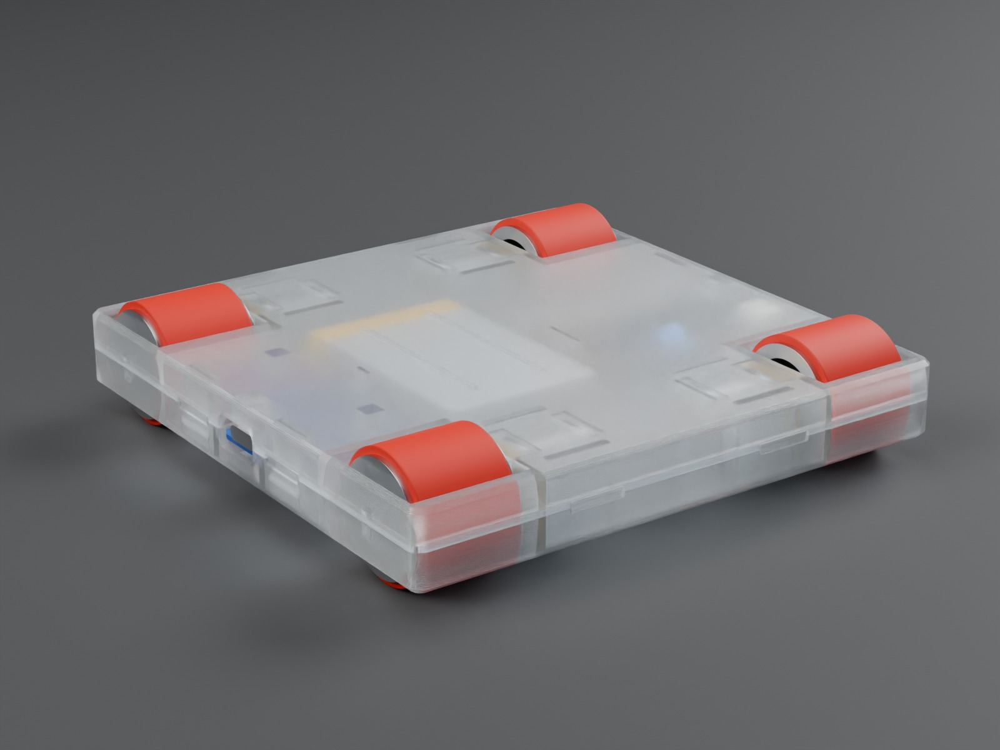
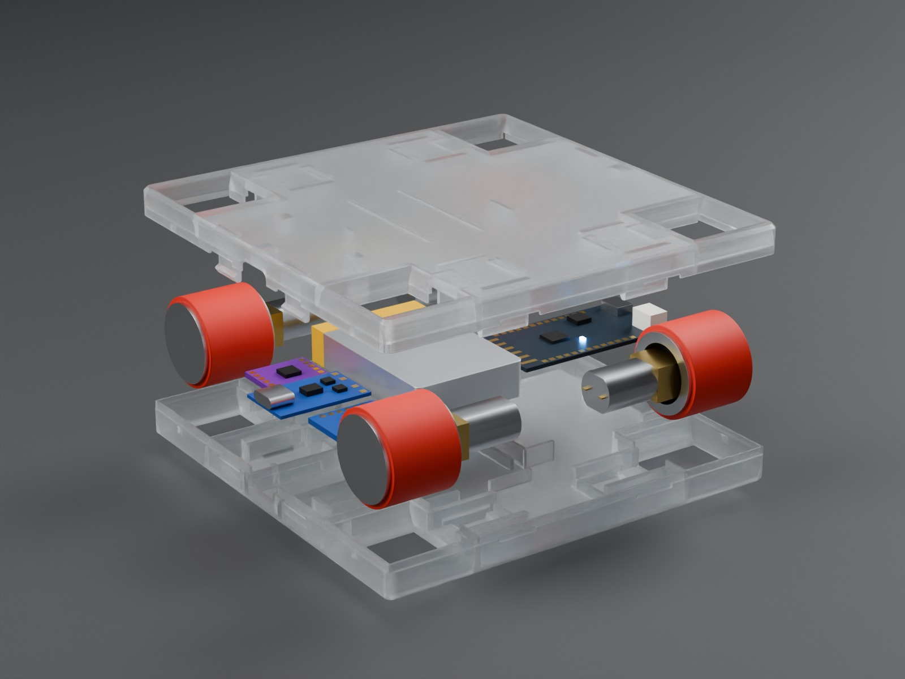
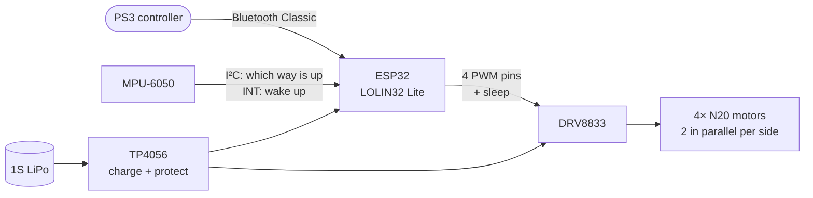
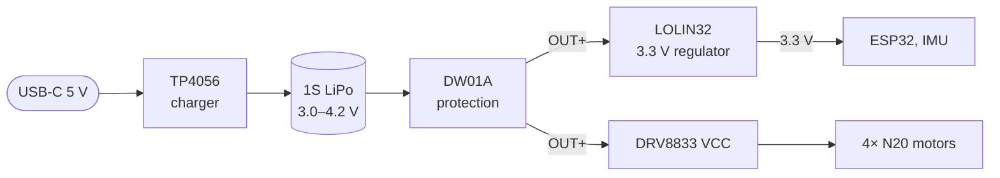
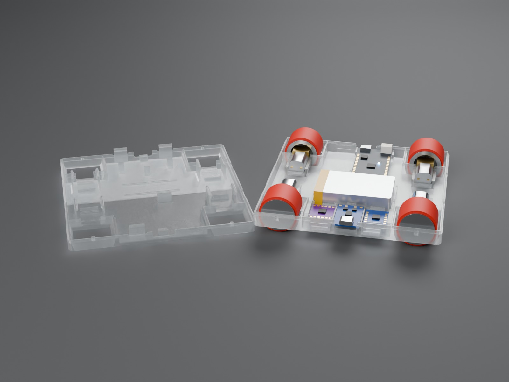

# minibot

A small invertible 4WD ESP32 robot driven by a PS3 controller over Bluetooth.

[](https://github.com/wouterds/minibot/actions/workflows/build.yml)
[](https://platformio.org)



## Overview

- **ESP32 (WeMos LOLIN32 Lite)** with Bluetooth Classic
- **PS3 DualShock 3 controller** as the remote
- **4× N20 6 V / 400 RPM** gear motors, paired left and right on one **DRV8833** dual H-bridge
- **MPU-6050 IMU**: when the bot lands on its back, forward stays forward. It also wakes the bot from sleep, so there is no power switch
- **TP4056 USB-C charge board with DW01A protection**
- **1S LiPo 3.7 V / 2000 mAh (103450)**, about two hours of cruising
- **Translucent PETG hull**, 123 × 123 × 16 mm, two shells that click together with the wheels inside. See [`cad/`](cad/README.md)



## Status

The firmware builds and the hull passes its fit checks in CAD. The drive code has not run on the bot yet. The base has been test-printed once and the parts drop in; the lid has not been printed, so the click is untested. [`cad/README.md`](cad/README.md#what-is-and-is-not-verified) lists what the model does and does not prove.

## System



## Wiring

No pin headers anywhere: every wire is soldered straight to a pad, so nothing stands taller than the 13 mm cavity.

| From | To | Purpose |
|---|---|---|
| Battery `+` / `−` | TP4056 `B+` / `B−` | The only place the battery connects |
| TP4056 `OUT+` | DRV8833 `VCC` | Motor supply |
| TP4056 `OUT+` | LOLIN32 battery `+` | Logic supply. Solder to the `+` leg of the JST socket; the board has no battery pin on its headers |
| TP4056 `OUT−` | LOLIN32 `GND`, DRV8833 `GND` | Common ground |
| LOLIN32 `3V3` | MPU-6050 `VCC` | |
| LOLIN32 `GND` | MPU-6050 `GND` | |
| `GPIO 32` | DRV8833 `IN1` | Left side |
| `GPIO 33` | DRV8833 `IN2` | Left side |
| `GPIO 25` | DRV8833 `IN3` | Right side |
| `GPIO 26` | DRV8833 `IN4` | Right side |
| `GPIO 27` | DRV8833 `EEP` | Wakes the driver. Low while the bot sleeps |
| `GPIO 19` | MPU-6050 `SDA` | |
| `GPIO 23` | MPU-6050 `SCL` | |
| `GPIO 34` | MPU-6050 `INT` | Wakes the ESP32 when the bot is moved |
| `GPIO 35` | middle of a 100 kΩ / 100 kΩ divider from battery `+` to `GND` | Battery voltage, optional |
| DRV8833 `OUT1` / `OUT2` | both left motors, in parallel | |
| DRV8833 `OUT3` / `OUT4` | both right motors, in parallel | |

Notes:

- **There is no power switch.** After three minutes without driving, the firmware puts the motor driver and the ESP32 to sleep and sets the IMU to watch for movement. Pick the bot up or nudge it and it wakes. Asleep it should draw around 1 mA, which is weeks on a full cell; that figure is an estimate, not a measurement.
- **Without the IMU the bot never sleeps**, because nothing could wake it again inside a sealed hull. The battery is then empty in a few hours.
- **`GPIO 21` is not on this board**, which is why I²C sits on 19 and 23. The onboard LED on `GPIO 22` is the status light.
- **The four motor pins are quiet during boot.** Several other pins pulse at reset and would twitch the motors.
- **A 220–470 µF capacitor** across the driver's `VCC` and `GND` keeps motor starts from browning out the ESP32.
- **The divider on `GPIO 35` is optional.** Once it is soldered in, set `BATTERY_SENSE_FITTED` to `true` in [`src/config.h`](src/config.h), put 100 nF from the pin to `GND`, and correct `BATTERY_DIVIDER` until the voltage in the serial log matches a multimeter.
- **If a side runs backwards**, swap the two motor leads of that side at the driver.
- **Mount the IMU component side up.** If the bot drives backwards the right way up, set `IMU_Z_SIGN` to `-1` in [`src/config.h`](src/config.h).
- **Never plug in both USB ports at once.** The LOLIN32 has its own charger; with both connected, two chargers feed one cell.

All pins are constants in [`src/config.h`](src/config.h). [`research.md`](research.md) has the reasoning.

## Power



The TP4056 board charges the cell from USB-C, and its DW01A cuts the output on overcharge, overdischarge, overcurrent and short circuit. That cutoff only comes at 2.4 V, so with the divider fitted the firmware stops the motors at 3.3 V, blinks the LED fast for half a minute and then powers the ESP32 down.

## Driving

| Control | Does |
|---|---|
| Left stick, up / down | Throttle |
| Right stick, left / right | Steering |

| Status LED | Means |
|---|---|
| Slow blink | Waiting for the controller |
| On | Connected |
| Fast blink | Battery low, motors off, going to sleep in 30 s |
| Off | Asleep. Move the bot to wake it |

The bot brakes when the controller stops sending for half a second. Speed changes are stepped, so a full reversal takes about 130 ms.

## Building

```sh
pio run                 # build
pio run -t upload       # flash over micro-USB
pio device monitor      # serial log
```

The PS3 controller only talks to the one Bluetooth address stored in it. The firmware gives the ESP32 the address in `HOST_MAC` ([`src/config.h`](src/config.h)). Plug the controller in over USB once and write that same address to it:

```sh
scripts/pair-ps3.py 24:6f:28:b1:f8:b6
```

## Hull



Two shells split on the axle line. The wheels run in wells inside the hull and stand 4.9 mm proud of both faces, so the bot drives the same on its back. Each motor reaches through the wall of its well into the hollow hub of its wheel. USB-C sits in the middle of the left side and micro-USB in the middle of the right side, both on the seam. There is no power switch: the bot sleeps when left alone and wakes when moved. Eleven snap fingers hold the lid, no screws.

Printing, assembly and tuning are in [`cad/README.md`](cad/README.md).

## Parts

See [`docs/parts.md`](docs/parts.md) for the full list.

| Component | Qty | ~Cost |
|---|---|---:|
| ESP32 LOLIN32 Lite | 1 | €5–8 |
| DRV8833 breakout | 1 | €1.50 |
| N20 6 V 400 RPM motor, long D-shaft | 4 | €10 |
| Wheel, ⌀26 × 22 mm, hollow hub | 4 | €7.20 |
| MPU-6050 module | 1 | €1.50 |
| TP4056 USB-C board with protection | 1 | €1–2 |
| 1S LiPo 2000 mAh (103450) | 1 | €8 |
| Capacitor, resistors, wire, foam tape | | €3–5 |
| Translucent PETG, ~80 g | | €2 |
| PS3 controller (reuse) | 1 | €0–20 |
| **Total** | | **~€37–43** |
