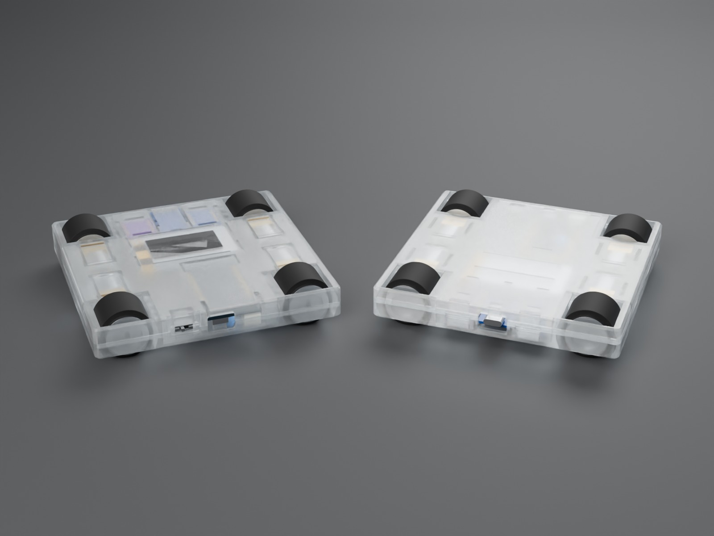
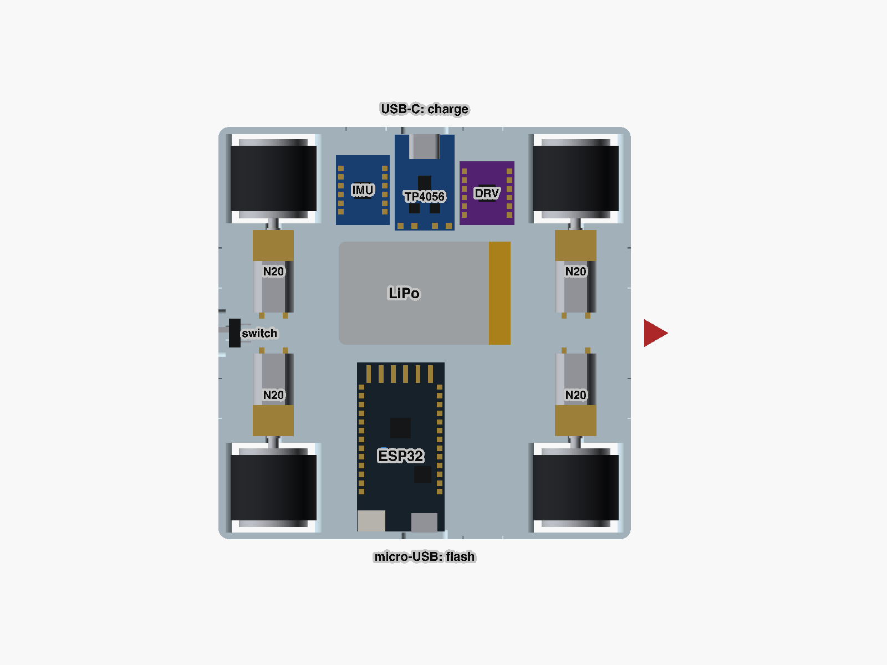
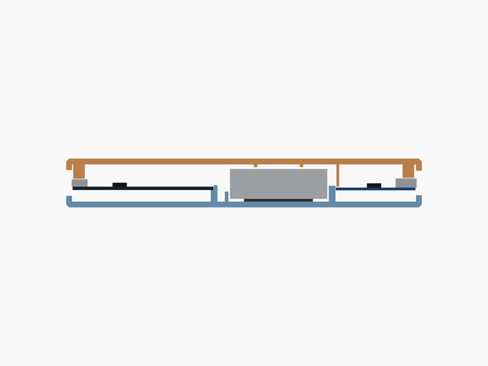
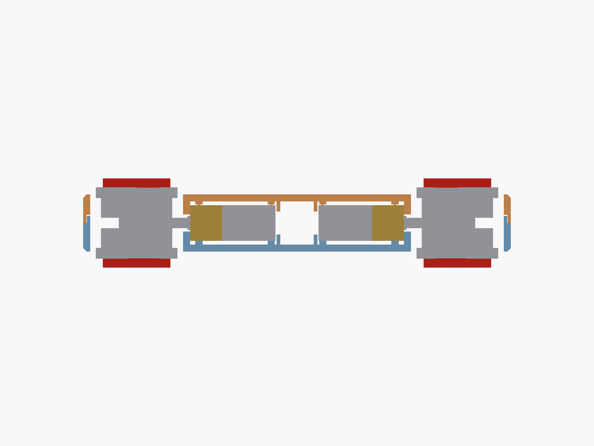
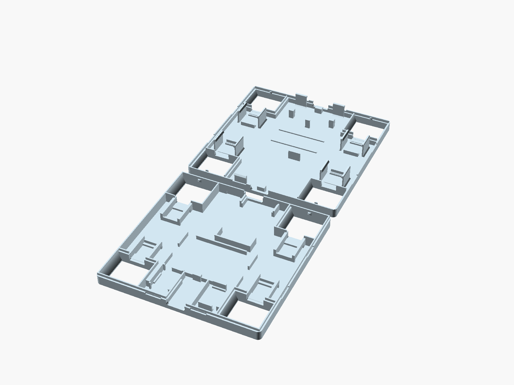

# Hull

Two printed shells that click together around everything, 123 × 123 × 16 mm, no hardware.

- **Wheels inside.** Each wheel runs in its own well. The well is a cylinder around the axle, so its wall stays 1.5 mm from the tyre all the way round. The wells are open to both faces and the tyres stand 4.9 mm proud of each, so the bot drives the same on its back. Nothing sticks out sideways, in front or behind.
- **Sealed middle.** The motors and the electronics sit in a closed cavity between the wells. The wheel hubs are hollow, and each motor reaches through the wall of its well so that the front of its gearbox stands 3.4 mm inside its hub. At that depth the tip of the shaft ends flush with the hub's outer face. A small stop on the outer wall of the well faces the shaft tip and keeps the motor and its wheel from sliding outwards.
- **Same either way up.** The shells split on the axle line and everything that goes through a wall is centred on that seam. USB-C for charging sits in the middle of the left side, micro-USB for flashing in the middle of the right side. Front and tail are plain walls, and there is no power switch: the firmware sleeps and the IMU wakes it.
- **Light and sound.** A 10 mm RGB LED lies on the centreline with its dome against the front wall, so the front of the hull glows and shows which end leads. A buzzer lies beside the ESP32. Each sits in a round cradle, half in the base and half in the lid.
- **Click fit.** Eleven snap fingers hang from the lid. Two grip the walls of every motor bay, right where the wheel loads come in, and three hold the side walls. A lip runs round the cavity and the whole outer wall and centres the lid.

`minibot.scad` is the whole design. Every dimension is a parameter at the top of the file.

## Layout

The red arrow points forward. Both USB sockets sit on the seam, so the cuts for them are the same in both shells.

The wires are drawn loose, in the colours of the [wiring table](../README.md#wiring), to show where they run: past the two ends of the battery, between the motors and over the small boards. None goes over the battery.

Cut across the middle, seen from the front: micro-USB and ESP32 on the left of the picture, battery on its foam tape in the middle, charger and USB-C on the right. The ribs coming down from the lid stop just above each part and keep it in place when the bot is on its back.

Cut through the front axle: wheels in their wells, motors between them, each one on two saddles in the base and under two in the lid.

## Printing

| File                  | Qty | Orientation     |
| --------------------- | --- | --------------- |
| `stl/base.stl`        | 1   | outer face down |
| `stl/lid.stl`         | 1   | outer face down |
| `stl/coupon-base.stl` | 1   | test piece      |
| `stl/coupon-lid.stl`  | 1   | test piece      |

The STLs are already in print orientation. No supports: nothing overhangs more than 45° except the hooks of the snap fingers and their grooves, which are 55° and under 1 mm deep.

**Print the coupon first.** It is the front right corner of both shells: one wheel well, one motor bay, two snap fingers. It takes about 12 g and shows whether the motor drops in, the wheel clears its well and the click feels right, before 80 g goes into the full shells.

Settings for translucent PETG on a 0.4 mm nozzle, starting from a 0.20 mm standard profile:

| Setting         | Value                              |
| --------------- | ---------------------------------- |
| Layer height    | 0.20 mm                            |
| Wall loops      | 4                                  |
| Order of walls  | inner / outer / inner              |
| Wall generator  | Arachne                            |
| Outer wall      | 60 mm/s                            |
| Top / bottom    | 5 / 5 layers, so the skins are solid |
| Sparse infill   | 15 % gyroid, hardly any is used    |
| Supports, brim  | off                                |

Dry the filament first. Wet PETG strings, and strings between a snap finger and the wall next to it glue the finger down.

The two outer faces print on the bed, so they take on its texture. A smooth plate gives clear faces.

## Assembly

1. Solder everything first, outside the hull. See the wiring table in the [main README](../README.md#wiring).
2. Push a hub onto each motor shaft, open end towards the motor, until the shaft tip is flush with the hub's solid face. Tighten the set screw, then roll the tyre on.
3. Lower each motor into its bay with the wheel in the well. The gearbox drops into the notch in the well wall.
4. Stick a strip of 1 mm foam tape on the floor between the battery fences and press the battery onto it.
5. Lay the boards in their seats: charger with its USB-C in the left wall, driver and IMU on either side of it, ESP32 with its micro-USB in the right wall.
6. Lay the LED in its cradle at the front, dome against the wall, and the buzzer in its cradle beside the ESP32, face against the wall of the wheel well. Turn each so its legs lie flat on the seam: they pass over the low stop behind it.
7. Tuck the wires down. They run past the ends of the battery and between the motors, not over the battery. Keep them off the walls of the motor bays and off the three places on the side walls where the fingers come down.
8. Set the lid on and press down beside each wheel until it clicks, then along the sides.

To open it, twist a coin in one of the slots on the seam. There are four at the ends, next to the wheels, and three on the sides.

## Tuning

The parameters most likely to need a change after the coupon:

- `motor_w`, `motor_h`, `motor_l`: the motor. `motor_l` runs from the brass front face to the black end cap, without the solder tabs.
- `motor_fit`, `motor_end_fit`, `motor_crush`: room beside and behind the motor, and how far the lid's crush ribs bite into it.
- `wheel_d`, `wheel_w`, `wheel_gap`: the wheel and the room around it. The hull's width follows from these.
- `shaft_l`, `wheel_w`: together they set how far the gearbox stands inside the hub.
- `snap_bump`, `snap_gap`, `snap_t`: how hard the lid clicks. A lid that pops off wants a bigger `snap_bump`; fingers that crack want a thinner `snap_t`.
- `snap_preload`: how firmly a closed lid is pulled down. Raise it if the lid rattles.
- `lip_h`: how far the base's lip stands into the lid, 1 mm. Through translucent plastic the overlap shows as a band along the seam, so it is kept low. Raise it if the shells shear apart in a drop.
- `wall`, `skin`: the outer walls and the two faces, both 1.6 mm. The two lips on the seam share the wall, so they are 0.7 mm each; a thinner wall leaves them too thin to print.
- `led_d`, `led_l`, `buzzer_d`, `buzzer_h`: the LED and the buzzer. Their cradles follow.
- `fit`: room around every board, per side. Raise it if a board does not drop into its seat.
- `esp_usb_off`, `esp_usb_h`, `usbc_h`: where the sockets sit on their boards. They decide whether the plugs line up with the openings.
- `usbc_open`, `usb_open`: the openings for the plugs, 13 × 7 mm and 12.5 × 7.5 mm. Both sockets sit behind the wall, so the grip of the plug has to pass through it, not just its metal tip. Widen one if a cable with a fat grip does not go in.

## Commands

- `./render.sh` regenerates the STLs and the preview images in `renders/`.
- `./check.sh` intersects every pair of parts and prints the volume they share. OpenSCAD does not complain when parts collide, this does.
- `./product/render.sh [shot ...]` ray-traces the product shots (`hero`, `pair`, `exploded`, `open`, `detail`).

They need the OpenSCAD snapshot build (`brew install --cask openscad@snapshot`) and, for the product shots, `uv`. Blender's renderer comes in through `uv` as a Python package.

After a change to the model, run all three and commit `stl/` and `renders/` with the source.

## What is and is not verified

Checked in the model:

- Both shells export as closed solids.
- With everything in place nothing overlaps, except where it is meant to: 9 mm³ where the snap fingers stay bent, and 3 mm³ where the crush ribs bite into the motors.
- The lid's ribs clear the base with the lid 0.2 mm off-centre in any direction.
- The wires as drawn clear both shells. They are stand-ins, real ones will lie where they fall.

Seen on a first print of the base, without the lid:

- The boards and the motors drop into their seats. With 0.25 mm of room per side they rattled, so the room around them is now 0.1 mm per side. With the lid off they still lift straight out: the base only locates the parts sideways, the lid holds them down.

Not checked yet:

- **The click.** Its strength depends on the printer and the filament.
- **Drops.** The fingers are printed standing up, which is the weak direction of a print. By calculation they hold roughly 190 N together. A wheel that lands hard levers its motor against the lid with about twice the force on the wheel, so a hard, flat landing on all four wheels may still pop the lid. Drop the coupon before trusting it.
- **A few dimensions.** Nearly everything is measured, see [`docs/measurements.md`](../docs/measurements.md). Still estimated: where the micro-USB sits across the ESP32 (taken from a video frame, good to about half a mm), the inside of the wheel hubs, and the thickness of the driver and IMU boards.
- **Radio range.** The ESP32's antenna ends 5.1 mm from the battery, which is close for a foil pouch.
